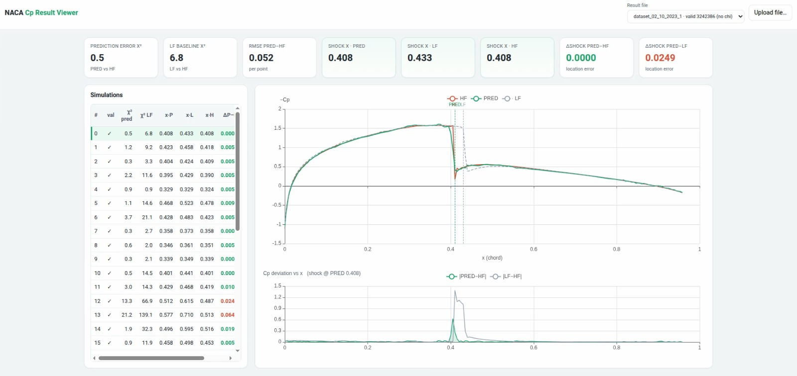

# CP Error-Correction Network

A neural network that learns to correct the pressure-coefficient (Cp) error of a
low-fidelity (LF) simulation by predicting the high-fidelity (HF) result.

## How to run

1 - 
Download and extract the dataset from: [datasets.zip](https://zenodo.org/records/23916811/files/datasets.zip?download=1)

2 - 
Install the necessary packages in `requirements.txt` 

3 - 
Run the main script:

```bash
python train_predict_cp.py
```

### Model

`HF_Predictor` (PyTorch) — input `(B, 200, 5)` channels-last:

- **Dilated Conv1d front-end** (16 filters, kernel 5): four blocks with dilations
  `1, 2, 4, 8` (padding chosen to keep the 200-point length), ReLU after each.
- **Global branch** — `AdaptiveAvgPool1d(1)` → `Linear(16, 40)` + ReLU. Computed in
  `forward()`, but **not** added to the output in the current implementation.
- **Point projection** — `Conv1d(16 → 40, kernel 1)` maps the conv features to the
  per-point `layer_size` (40), reshaped to `(B, 200, 40)`.
- **Two identical 3-layer per-point branches** (sizes `5 → 44 → 42 → 40`):
  - `nl`: ReLU after each layer.
  - `ln`: no activation (purely linear).
- **Fusion** — element-wise `z = ln + nl + conv` → `Linear(40, 1)` → `(B, 200, 1)`.
- Init: `kaiming_normal_` (HeNormal) on all Linear/Conv1d weights, zero biases.
- Loss: `F.smooth_l1_loss(pred, y, beta=0.05)`.


### Notes

- The train/validation split is a **sequential** index split (first 80 / last 20)
  applied after shuffling (`train_fract = 0.80`).
- Leading parameters are scaled by `/max` only (no min shift), whereas the LF/HF
  `(x, y, cp)` arrays are min-shifted then `/max`.

## Result viewer

A standalone Node/Express + ECharts web app (`result_viewer/`) to browse the
`results/` CSVs, compare PRED vs LF vs HF, and read off shock locations and errors.
This code of the visualizer has been partially generated with AI assistance.

```bash
cd result_viewer
npm install          # once
npm start            # -> http://localhost:8050
```

It scans `results/` for `*_xyz_*.csv` files and, per
simulation, computes and shows:

- The Cp curve PRED / LF / HF with a vertical marker at each shock location.
- chi² error vs HF and vs LF
- RMSE pred-vs-HF.
- Shock location (x) for PRED / LF / HF, and the location error PRED-vs-HF and
  PRED-vs-LF.
- A per-simulation table, plus aggregate stats over all simulations.

The shock is detected as the largest adjacent Cp jump on the chordwise-ordered
upper surface.

The `results/` directory is resolved from the script's parent dir and can be
overridden with the `RESULTS_DIR` env var.



The interface shows, at the top, the prediction error chi², LF baseline chi²,
RMSE PRED-HF and the shock locations for PRED / LF / HF with their location
errors. On the left, a sortable table lists every simulation; on the right,
the main chart plots `-Cp` versus chord `x` for HF, PRED and LF with vertical
markers at each shock, and the lower chart shows the Cp deviation between
PRED-HF and LF-HF along the chord.

## Experiment summary

All experiments use the same data, fixed shuffle seed `42`, the same
shock/chi filters, and the same 80/20 sequential simulation split.  The
colocation experiments change the number of selected points, while the
interpolation-method audit separately changes the LF/HF mapping method.

### Metric definitions

All curve-fit metrics are computed from the saved `_xyz_*.csv` result files
without retraining.  In the tables, metric values are means over simulations.

- **RMSE**: root mean square pointwise prediction error,
  `sqrt(mean((pred_i - HF_i)^2))`.  It measures overall magnitude of error.
- **MAE**: mean absolute pointwise prediction error,
  `mean(|pred_i - HF_i|)`.  It is less sensitive to large outliers than RMSE.
- **Pearson correlation**: linear correlation coefficient between prediction
  and HF, `cov(pred, HF)/(sigma_pred sigma_HF)`.  It measures monotonic
  association, not error magnitude; a high correlation can coexist with
  large pointwise error.
- **Total variation ratio**: `TV(pred)/TV(HF)`, where
  `TV(x) = sum_i |x_{i+1} - x_i|`.  A ratio near 1 means similar total
  variation; below 1 means the prediction is smoother, above 1 means it
  oscillates more.
- **Derivative sign changes**: number of sign changes in the first differences
  `pred_{i+1} - pred_i`; this counts oscillations/extrema in the prediction.
  The raw count scales with the number of points, so compare counts at the
  same point count or use density/TV ratio for cross-count comparisons.
- **Residual total variation**: `TV(pred - HF) = sum_i |(pred_{i+1}-HF_{i+1})
  - (pred_i-HF_i)|`.  A large residual TV means the prediction wiggles
  around the HF curve even if RMSE is moderate.
- **Shock error**: absolute difference between the predicted shock location
  and the HF shock location.  The value is in the normalized chordwise
  coordinate used by `train_predict_cp.py` and the result CSV, not in
  physical metres.

### Files

| experiment | script | result directory |
|---|---|---|
| optimized baseline 200 points | `colocations_opt/train_200.py` | `colocations_opt/results_200` |
| optimized baseline 100 points | `colocations_opt/train_100.py` | `colocations_opt/results_100` |
| optimized baseline 50 points | `colocations_opt/train_50.py` | `colocations_opt/results_50` |
| optimized baseline model | `refined/global_conv_nl_min12.py` | `refined/results_global_conv_nl_min12` |
| no global branch | `ablation/no_global_branch.py` | `ablation/results_no_global` |
| no nonlinear branch | `ablation/no_nonlinear_branch.py` | `ablation/results_no_nonlinear` |
| no Conv front-end | `ablation/no_conv_frontend.py` | `ablation/results_no_conv_opt` |
| interpolation RBF | `interpolation/train_200_rbf.py` | `interpolation/results_rbf` |
| interpolation nearest | `interpolation/train_200_nearest.py` | `interpolation/results_nearest` |
| interpolation linear | `interpolation/train_200_linear.py` | `interpolation/results_linear` |
| interpolation gradient-adaptive | `interpolation/train_200_adaptive.py` | `interpolation/results_adaptive` |

Shared corrected runner: `experiments/common.py`.

### Colocation results

All three runs use the same optimized baseline:
global branch ON, Conv front-end ON, nonlinear per-point branch ON,
linear branch OFF, `layer_size=12`, `hidden_layers=2`, `conv_filters=8`,
3000 epochs.

The selected segment is preserved.  50 and 100 use evenly spaced subsets
of the same 200-point segment.

#### All simulations

| points | MAE | Pearson | TV ratio | deriv. sign changes pred | deriv. sign changes HF | residual TV | shock | RMSE |
|---|---:|---:|---:|---:|---:|---:|---:|---:|
| 50 | 0.0237156 | 0.9938520 | 1.0072585 | 7.0417 | 3.1786 | 1.5111428 | 0.0137687 | 0.0565412 |
| 100 | 0.0293230 | 0.9901879 | 1.0210297 | 14.9524 | 3.8452 | 2.7558136 | 0.0544947 | 0.0832451 |
| 200 | 0.0276002 | 0.9905176 | 1.0066010 | 27.9107 | 9.4524 | 3.6881450 | 0.0212028 | 0.0817696 |

#### Validation subset

| points | MAE | Pearson | TV ratio | deriv. sign changes pred | deriv. sign changes HF | residual TV | shock | RMSE |
|---|---:|---:|---:|---:|---:|---:|---:|---:|
| 50 | 0.0274892 | 0.9921440 | 1.0132975 | 7.9412 | 3.1176 | 1.7658543 | 0.0180249 | 0.0702429 |
| 100 | 0.0328120 | 0.9865971 | 1.0315599 | 15.7647 | 3.7647 | 3.0281767 | 0.0406967 | 0.1007897 |
| 200 | 0.0310718 | 0.9867896 | 1.0227078 | 28.7941 | 9.3824 | 3.9766648 | 0.0249132 | 0.0987101 |

### Corrected comparison against raw 200-point HF

Comparing the low sampling vs the full sampled.

| points (evaluated on 200 raw points) | split | MAE | Pearson | TV ratio | deriv. sign changes pred | deriv. sign changes HF | residual TV | shock | RMSE |
|---|---:|---:|---:|---:|---:|---:|---:|---:|---:|
| 50 | all | 0.0272403 | 0.9909024 | 0.9104344 | 7.0417 | 9.4524 | 3.4270526 | 0.1724907 | 0.0831175 |
| 50 | valid | 0.0298498 | 0.9900799 | 0.9202839 | 7.9412 | 9.3824 | 3.5944731 | 0.1533324 | 0.0887810 |
| 100 | all | 0.0291912 | 0.9901032 | 0.9517827 | 14.9524 | 9.4524 | 3.5754282 | 0.0835497 | 0.0862958 |
| 100 | valid | 0.0318279 | 0.9879457 | 0.9660380 | 15.7647 | 9.3824 | 3.7522886 | 0.0891972 | 0.0971810 |
| 200 | all | 0.0276002 | 0.9905176 | 1.0066010 | 27.9107 | 9.4524 | 3.6881450 | 0.0212028 | 0.0817696 |
| 200 | valid | 0.0310718 | 0.9867896 | 1.0227078 | 28.7941 | 9.3824 | 3.9766648 | 0.0249132 | 0.0987101 |

### Interpolation-method

This is a separate preprocessing-sensitivity experiment.  It keeps the
optimized 1685-parameter architecture but changes the LF/HF mapping method.

The linear run uses nearest-neighbour fallback when `LinearNDInterpolator`
returns NaN, so all runs keep the same 168/34 split.

#### All simulations

| method | MAE | Pearson | TV ratio | deriv. sign changes pred | deriv. sign changes HF | residual TV | shock | RMSE |
|---|---:|---:|---:|---:|---:|---:|---:|---:|
| RBF | 0.0298395 | 0.9900481 | 1.0265847 | 29.5000 | 9.4524 | 3.8976596 | 0.0325735 | 0.0845496 |
| nearest | 0.0280187 | 0.9911963 | 1.0062727 | 26.3869 | 9.4524 | 3.7243780 | 0.0259928 | 0.0807042 |
| linear | 0.0269129 | 0.9917892 | 0.9966397 | 27.3929 | 9.4524 | 3.5621815 | 0.0137661 | 0.0759354 |
| adaptive | 0.0246434 | 0.9920480 | 0.9700641 | 22.6190 | 9.4524 | 3.2202822 | 0.0100838 | 0.0734726 |

#### Validation subset

| method | MAE | Pearson | TV ratio | deriv. sign changes pred | deriv. sign changes HF | residual TV | shock | RMSE |
|---|---:|---:|---:|---:|---:|---:|---:|---:|
| RBF | 0.0333538 | 0.9863632 | 1.0472670 | 29.9118 | 9.3824 | 4.2033595 | 0.0273740 | 0.1008936 |
| nearest | 0.0302256 | 0.9890673 | 1.0263851 | 26.0000 | 9.3824 | 3.9578369 | 0.0308606 | 0.0919980 |
| linear | 0.0287469 | 0.9894184 | 1.0137340 | 29.8235 | 9.3824 | 3.8331546 | 0.0108951 | 0.0881596 |
| adaptive | 0.0266630 | 0.9898101 | 0.9863850 | 23.4706 | 9.3824 | 3.5139156 | 0.0103091 | 0.0858114 |

### Architecture-ablation

| ablation | params | mean RMSE PRED-HF all | mean RMSE PRED-HF valid | mean shock error PRED-HF all | mean shock error PRED-HF valid |
|---|---:|---:|---:|---:|---:|
| optimized baseline | 1685 | 0.0817696 | 0.0987101 | 0.0212028 | 0.0249132 |
| no global branch | 1577 | 0.085716 | 0.096008 | 0.018131 | 0.025770 |
| no nonlinear branch | 1421 | 0.078097 | 0.094972 | 0.006552 | 0.007290 |
| no Conv front-end | 349 | 0.193608 | 0.208761 | 0.063203 | 0.068157 |

### Running

```bash
python experiments/colocations_opt/train_200.py
python experiments/colocations_opt/train_100.py
python experiments/colocations_opt/train_50.py
python experiments/refined/global_conv_nl_min12.py
python experiments/ablation/no_global_branch.py
python experiments/ablation/no_nonlinear_branch.py
python experiments/ablation/no_conv_frontend.py
```

To visualize results

```bash
cd result_viewer
RESULTS_DIR=../experiments/colocations_opt/results_50/results npm start
```

Or manually load them through the interface.